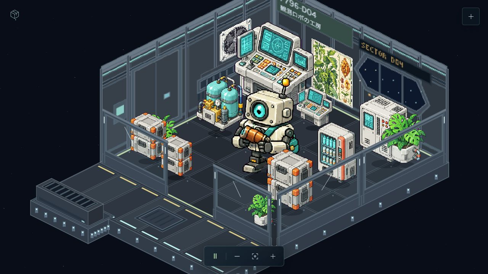

# CHAOS FLOOR Starter

好きなテーマを、同じ画風のキャラクター・小物・動く宇宙ステーションにする制作キットです。
オリジナルの「観測ロボの工房」が入っているので、画像生成サービスの契約前でも起動できます。




[Use this template](https://github.com/aiko-obara/chaos-floor-starter/generate) から自分のリポジトリを作るか、[最新版ZIP](https://github.com/aiko-obara/chaos-floor-starter/releases/latest) をダウンロードしてください。

## まず起動する

Python 3.12以降とNode.js 22以降を用意し、プロジェクトのフォルダで実行します。macOS/Linuxの例です。

```sh
python3 -m venv .venv
source .venv/bin/activate
python -m pip install -r requirements-sprites.txt
npm run check
npm run dev
```

Windows PowerShellでは `python -m venv .venv` と `.venv\Scripts\Activate.ps1` を使い、以降のコマンドは同じです。
[http://127.0.0.1:4173/](http://127.0.0.1:4173/) を開きます。ドラッグ・ピンチ・ズーム・再生停止を試せます。右上の＋から一式を別の番地へ配置し、「配置を保存」でJSONを書き出せます。
起動だけならPython標準ライブラリで `python app/server.py` を実行できます。終了はCtrl+C。

## 自分のテーマを作る

このフォルダをCodexで開き、次のように依頼します。

> `$chaos-theme` を使って「星を集める郵便屋さん」のテーマを追加して。今ある工房と同じ画風で、手紙を仕分ける動きと関連小物も作って。

[制作スキル](.agents/skills/chaos-theme/SKILL.md) が自動認識されない場合は、このファイルを明示してください。
[制作工程](.wiki/wiki/implementation-process.md) に、画像の同定、画風参照、動作設計、原画、加工、配置と保存、確認基準をまとめています。
新しい原画の制作には、画像生成・検索を利用できるCodex環境が必要です。Web画面の任意入力からの自動生成APIは未接続です。APIキーなしの起動・編集・既存アニメーションの再生で、生成APIが勝手に呼ばれることはありません。

## 素材とJSONを持ち運ぶ

`app/public/assets/sample.json` は使えるテーマ、`worlds/personal/world.json` は公開する配置です。作者の編集中の配置はブラウザに保存されるので「配置を保存」で書き出します。

```sh
python scripts/import_world.py ~/Downloads/chaos-floor-796.json
npm run build:public
```

画像の参照切れを検査して、公開配置を更新します。**JSONと参照するPNG/atlasを必ず一式で管理**してください。
[新テーマを追加する手順](docs/CREATE_A_THEME.md)、[Cloudflare公開](docs/DEPLOY.md)、[素材の来歴・利用条件](docs/ASSETS.md)も参照してください。

## 加工を再現する

```sh
npm run check:sprite-recipe
```

デモの原画・prompt・仕上げ処理から最終atlasを再構成し、RGBA画素の一致を確認します。PNGの圧縮方式によるバイト差と、見た目の差を区別します。新しい画像生成結果には揺らぎがあるため、同じ画風・品質は参照と採用基準で確認します。

## 構成とライセンス

コードと同梱のオリジナルデモ素材は [MIT License](LICENSE)。外部パッケージは各配布元のライセンスに従います。第三者のキャラクター画像や検索元画像は含めていません。
`app/` が編集ビューア、`scripts/` が加工・公開ビルド、`recipes/` が再現用の設定、`.agents/skills/` が制作手順、`.wiki/` が決定と制作記録です。
GitHub Actionsが起動データ・加工・公開ビルドを確認します。自動デプロイや課金サービスの設定は含みません。
